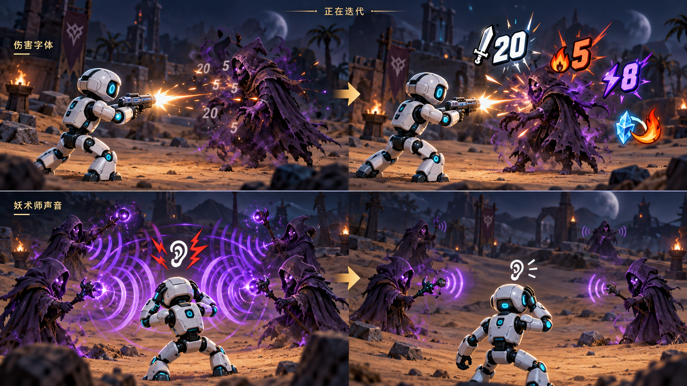

# 试玩反馈与设计改进

[返回作品首页](../README.md) · [系统设计](SYSTEM_DESIGN.md) · [当前反馈与修订预期](https://github.com/Meracle-sjj/AICompanionDemo/issues/7)

这里收录已经改善的体验问题与漫画图解，并单独记录仍在迭代的声音。图为 AI 生成的机制／设计方向示意，具体规则与验证范围以文字和对应记录为准。

本轮新实现位于 **v1.3.4-preview 开发候选，尚无正式发行**；正式下载仍为 v1.3.3。

| 反馈 | 来源 | 当前状态 |
| --- | --- | --- |
| 召唤师火球看起来没碰到角色，却造成伤害 | 作者的朋友，开发阶段内部版本试玩 | 空间判定已改善 |
| 伤害数字细小、类型与实际数值不易辨认 | 作者试玩反馈 | 漫画描边、类型图标／配色与完整伤害已改善 |
| 妖术师提示声沉闷、太轻；铡刀声缺少清脆金属感 | 作者最新试听反馈 | 妖术师恢复原版及限制已有实测；铡刀网站 C 已导入并在生产入口起播，游戏内听感待确认 |
| Boss 触发瞬间伤害与开场语音被覆盖 | 作者试玩；随后否决首版屏幕数字／文字／框 | 三秒现场光柱、冻结与三级语音已有受控结果，新包及自然体验待验 |

## 火球：可见接触与伤害一致

**问题来自朋友的内部试玩。** 开发阶段，作者的朋友发现召唤师攻击常常莫名其妙命中自己。追查后发现，旧命中逻辑只看水平距离，忽略了火球与角色的高度差：视觉上飞过头顶，逻辑上仍可能扣血。

**改善后的规则：** 可见球核与 35 cm 连续球扫统一，沿三维弹路检查角色实际胶囊和阻挡地形。火球飞越时安全；首次接触才结算，地形先挡住则销毁，同距时地形优先。图中的蓝色胶囊表示角色碰撞边界。

旧高空误伤曾在受控场景真实复现；修订后取得自然发射和地形阻挡记录，作者随后确认正常。这个案例体现了从玩家感受到的不公平，追查到几何规则，再约束视觉与伤害的一致性。实现见 [BossOrb.cpp](../Source/AICompanionDemo/AI/BossOrb.cpp)。

## 伤害数字：让攻击结果一眼可读

**作者反馈：** 数字太细，拥挤战斗中难以读清，也难以分辨伤害机制。改善后采用漫画描边、类型图标与配色：普通攻击为白色小剑，火焰亮红、流血暗红、雷电紫色，融化采用冰晶＋火焰双图与混色数字。

**数值保持战斗语义：** 显示模式／减伤后的完整攻击强度，生命账本仍按目标剩余血量实际扣除。例如 20 伤命中只剩 3 血的敌人，显示 20，实际扣 3。原火与异人融化各自结算、分别显示；免伤、零伤害与已死目标保持静默。

这些改动已接入 v1.3.3，并完成完整 Windows 构建、Cook、限定机制检查与两次独立冷启。图中的表现属于设计示意；自然整局、全部构筑与长期性能仍有待验证。设计与阶段记录见 [issue #5](https://github.com/Meracle-sjj/AICompanionDemo/issues/5)、[issue #6](https://github.com/Meracle-sjj/AICompanionDemo/issues/6)。

## 声音：继续以实际试听判断

上图右侧保留声音迭代时的原目标。妖术师试过多版短声，作者反馈仍是沉闷、太轻，因此当前恢复原版 `beam_charge`／`beam_fire`。最终 Editor 已核 0.4／0.45、pitch 1，以及并发 2、24 米距门与成功间隔；玩家距离、暂停及死亡清理限制继续保留，当前危机感仍待作者自然体验。

铡刀先提供的两组自制音效被作者否决，随后改从网站试听。作者选 C：CC0 StarNinjas Sword #10，保留完整挥斩音色，现已导入独立 SoundWave，并从真实玩家弹射／主攻成功地刺两种生产入口记录到音频线程起播；旧音保留。网站试听认可与游戏内混音体验分开，Cook 和新包人耳验收尚待完成。来源与许可见[资源说明](THIRD_PARTY.md)。

Boss 开场语音被生命警告覆盖的问题已改为 Boss／生命／其他三级调度，当前 Boss 台词不可被任何新语音切断；本轮实际起播已核 Boss→Boss→恢复→普通卡词，以及生命提醒抢普通。召唤预备的首版屏幕数字、文字和框虽完成受控检查，作者看过后否决；最终改为现场红光柱在三游戏秒内逐渐扩大并覆盖祭坛，再唯一生成 Boss。新光柱已有真实扩张、旧 UI 为 0 和暂停／奖励冻结的独立原件；画面复核使用临时近址／镜头夹具，未称自然远址或完整一局通过。旧首版否决历史保留，阶段记录见[当前迭代 issue #7](https://github.com/Meracle-sjj/AICompanionDemo/issues/7)。

后续关键改动继续用漫画表达问题、设计判断和改善后的规则，保留每个问题的真实来源与迭代记录。

<!-- V134_ACTUAL_PACKAGE_RECEIPT -->

本轮新完整 Win64 BuildCookRun 已于 181.92 秒成功；官方容器核对所选刀剑声、光柱材质、原版妖术师两声与唯一原 BGM，包内 1.3.4-preview／声音路由核同。两独立子进程冷启（1280×720、960×540）均挂载开始菜单并按 EngineLoop 时限正常 OS0 退出、无 Fatal；仅启动与退出，不代键鼠、自然整局或人耳混音。Cook 汇总 0 错误／5 警告，日志中的既有 KeyGlow 缺失原件保留。当前为本地试玩候选，尚无新正式 Release。
