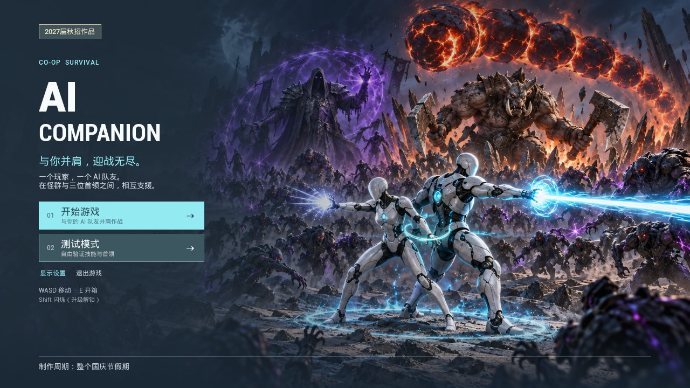

# 1.1候选发布记录

版本目标：`1.1`，记录日期2026-10-10（北京时间）。UE5.6.1 / Windows x64 / Development。**1.1源码已实装、Editor与完整BuildCookRun通过，独立候选已启动到开始界面；ZIP封包、附件上传与独立包核心操作尚未完成。当前下载仍为1.0。**

首版记录完整保留：[1.0发布记录](RELEASE_1.0.md) · [1.0本地验证记录](RELEASE_VALIDATION_1.0.md) · [1.0 Release](https://github.com/Meracle-sjj/AICompanionDemo/releases/tag/v1.0)。没有修改首版标签或下载附件。

## 下载与启动

[下载Windows 1.0试玩ZIP](https://github.com/Meracle-sjj/AICompanionDemo/releases/download/v1.0/AICompanionDemo-Win64-v1.0.zip)。首版为1,191,367,670 B（约1.19 GB / 1.11 GiB），SHA-256与完整性记录见[1.0归档](RELEASE_1.0.md)。**这里没有1.1下载链接；1.1压缩体积、SHA-256与远端下载核对待交付后追加。**

完整解压玩家ZIP，保留所有子目录，运行根目录 `AICompanionDemo.exe`；无需Unreal Editor或API密钥。首次缺少Visual C++运行库时安装随包官方x64安装程序。源码ZIP不含Content，不能直接游玩或完整恢复工程。操作与新增规则见[玩家指南](../PLAYER_GUIDE.md)。

| 1.1交付项目 | 当前真实状态 |
| --- | --- |
| 公开实施记录 | [先行预期#1](https://github.com/Meracle-sjj/AICompanionDemo/issues/1)保留；代码实施提交`938ec81`，设计／版本／机制图提交`c538d0e` |
| Editor构建 | 完整Editor构建成功，21.54s；首次C4458失败记录保留 |
| Build／Cook／Stage／Archive | 完整BuildCookRun成功，225.27s，退出0；全文仍有既有KeyGlow错误记录 |
| 独立候选启动 | 通过根bootstrap启动；全新用户配置回读1280×720、窗口模式2，真实开始界面显示「显示设置」；另一轮正常退出 |
| PIE专项 | 免费箱、等级队列／Flip、重复成长、奖励暂停、菜单清局、事件／语音与文字几何取得实际回读；覆盖范围见[验证记录](RELEASE_VALIDATION.md) |
| 独立包核心游玩 | **待验**：开始／测试、实际键鼠、战斗、成长、死亡、Boss／终局和全屏切换；PIE回调不替代这些操作 |
| 玩家ZIP／源码ZIP／公开附件 | **待交付**：最终大小、SHA-256、解码核对与匿名下载尚未在本记录中完成 |
| 可信发布者签名 | **未解决**：没有适用可信签名凭证，不以自签或关闭校验替代 |

上图来自实际独立Development候选的 `Shot SHOWUI`，尺寸1280×720；只证明开始页与显示设置入口出现，不证明点击、战斗或全屏体验通过。

## 本轮内容与版本边界

作者异机试玩1.0后提出11项反馈，先在[公开预期](ITERATION_1.1.md)记录目标，再实施。1.1包含首开窗口与可保存显示设置、测试面板菜单／收起、ESC与应用失焦暂停、免费初始箱、标准杂兵基础降速、队友当前路径段与请求去重、猎印真实说明、事件回看，以及Lv.9起的玩家／AI等级奖励交替。玩家奖励第三槽的Flip仅转换当前候选；新增本体速射和有限次数陪伴疾行。实现和实际测量见[版本日志](../CHANGELOG.md)、[系统说明](SYSTEM_DESIGN.md)与[1.1验证记录](RELEASE_VALIDATION.md)。

目录为32个升级／操作显示ID，加九遗物共41项展示元数据；Flip、填位与兼容条目不能算作41种技能。PIE成长试验调用真实经验／授予／选择入口，但不等于自然随机池分布、真实敌人全部叠层消费或完整构筑已验。

运行时仍为离线C++ FSM／Utility AI。台词为固定文本和预合成语音，不调用LLM、Embedding或在线TTS；玩家无需智谱或其他API配置。新增Lv.6解锁语音已在PIE读到真实SoundWave播放、时长4.44s，并实际进入Cook；没有扬声器听音确认。

## 资产与发布限制

本轮仍使用独立候选副本清空BGM槽并NeverCook `/Game/BGM`，原工程音乐与用户资产保留。候选Cook目录的BGM非空文件数为0。新增解锁语音Cook文件为801／92,581／130 B；文件进入Cook不等于全部音频或授权已经验收。许可取得／输出分发记录缺口见[第三方资源说明](THIRD_PARTY.md)，不宣称全部清权。

公开仓仅白名单源码、配置、文档、图源与发布工具；原Content和旧Git历史继续保全，不公开第三方裸素材。缺失资产的恢复条件、完整工程与源码评审范围见[仓库说明](REPOSITORY.md)。

Development引擎的TraceControl可能触发Windows网络权限提示，与离线游戏AI及发布者签名属于不同问题。首版记录了TCP1985监听和输入阻塞，本轮不宣称这些提示已消除，也不修改系统防火墙。

## GitHub附件方案

玩家包放GitHub Releases，源码和文档进入普通Git；1.0附件继续可用。GitHub单Release附件须小于2GiB（2,147,483,648 B），每个Release最多1,000个附件；总资产体积／带宽没有总额限制。[GitHub官方Releases说明](https://docs.github.com/en/repositories/releasing-projects-on-github/about-releases) 1.1能否满足单附件大小以最终压缩字节数为准，目前不沿用1.0体积作为1.1测量。

普通Git超过50MiB警告、超过100MiB拒绝；玩家ZIP不入Git，当前白名单源码没有启用LFS的必要。[GitHub官方大文件说明](https://docs.github.com/en/repositories/working-with-files/managing-large-files/about-large-files-on-github) 后续附件上传及校验通过后再将本页状态改为已发布，不以候选启动或源码推送代替发布完成。
