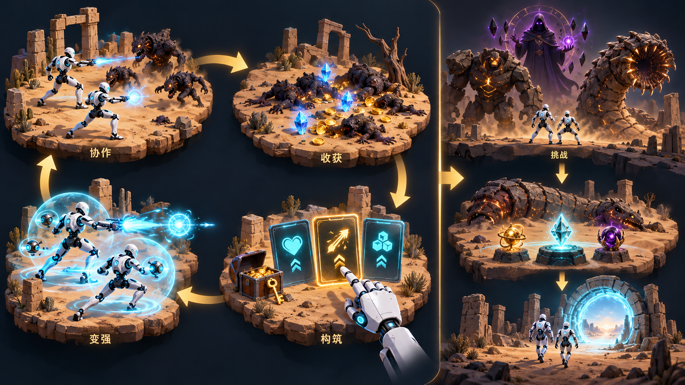
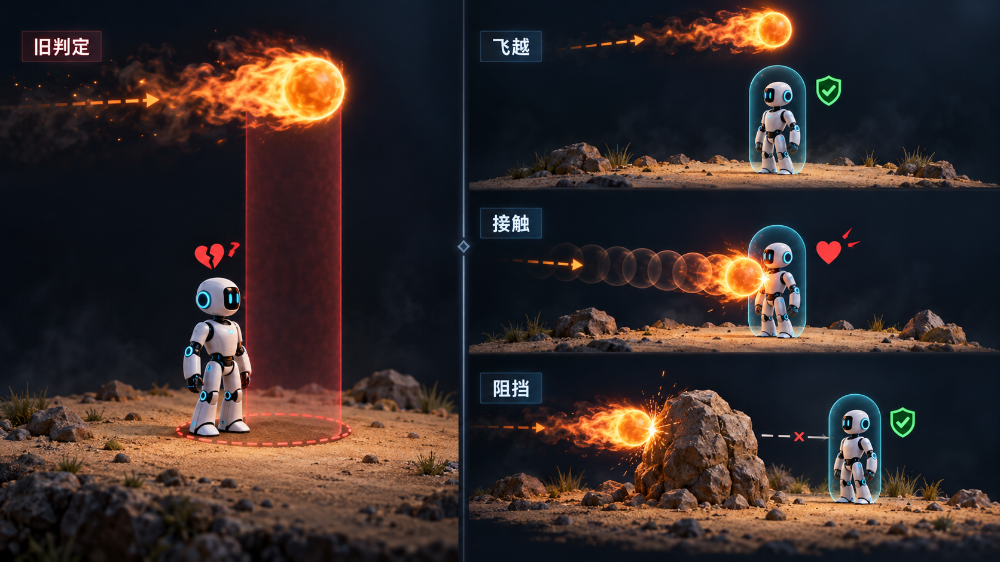

# AI队友协作生存原型：v1.3.5-preview 系统设计

**本文对应 v1.3.5-preview；v1.3.3 继续保留为稳定版。** 本轮修复高 DPI 与无边框物理像素查询，调整伤害数字的字号、拥挤透明度和错层排布；继承 v1.3.4-preview 的单元素成长、Boss 预备窗口／语音优先级、弹射遗物及终局规则。历史版本的构建和验收按各自时点保留，不能代替本轮结果。[v1.3.5-preview 试玩入口](https://github.com/Meracle-sjj/AICompanionDemo/releases/tag/v1.3.5-preview) · [v1.3.3 稳定版](https://github.com/Meracle-sjj/AICompanionDemo/releases/tag/v1.3.3) · [本轮修订记录](https://github.com/Meracle-sjj/AICompanionDemo/issues/8) · [作品入口](../README.md) · [玩家指南](../PLAYER_GUIDE.md) · [修订摘要](../CHANGELOG.md)

## 设计目标与核心循环

自动战斗降低操作负担后，玩家仍需通过站位、护卫／歼灭切换、构筑选择、金币消费和挑战时机参与战局。玩家前期借助队友火力生存，Lv.6 解锁自身自动射击；协作路线让玩家制造状态、队友参与结算，形成持续的分工。



| 成长入口 | 当前规则 | 设计目的 |
| --- | --- | --- |
| 经验升级 | 三选一，按前置、互斥和次数筛选；Lv.9 起交替玩家／AI等级奖励 | 让成长收益和受益方更清楚 |
| 经济与探索 | 普通箱价为 `3 + 2 × 已开箱数`；锁箱给 15 金与六选二 | 让即时强化与探索竞争时间和资源 |
| 风险祭坛 | 花费 8 金增加压力；敌人生命、经验分别乘 `1 + 0.3L`、`1 + 0.25L` | 让玩家主动交换风险与成长效率 |
| Boss 奖励 | 三个 Boss 各提供三种专属遗物，击败后选一，与其他奖励串行领取 | 以机制挑战打开构筑分支 |

普通、稀有、传说的相对权重乘子分别为 1.0、0.75、0.45，并非固定出卡概率。展示目录包含 32 个升级／操作项与九种遗物；Flip、金币填位和兼容项也在目录内，不能据此称为 41 种技能。

玩家冰／电／猎印路线互斥。候选池、槽位领取和效果提交共用一项兼容判断，同时核对持有账本与玩家实际状态；跨线拒绝先于奖励记账。大锁箱在未选线时保留不同路线供比较，首领元素后把未领冲突槽转换为 15 金币袋，保留六槽布局和第二次领取，避免以锁死奖励来补互斥漏洞。玩家穿透与折射可以同持，每个直接命中最多带一次不递归分叉，整发去重；散射与这两项互斥。队友穿透与折射保持互斥。融合按前置组合进入候选池，让玩家通过选择形成路线。

裂地獠牙的针刺默认概率为 30%，完整卡面说明读取同一参数。主攻首个命中仍整发回调一次；成功弹射命中在整发目标去重后另走仅含地刺的概率入口，闪现轰击也保留该独立入口。弹射不会重复主攻震爆／熔核爆弹，地刺和流血只向 Health 提交次生伤害，不回调攻击链。直伤 50 与 5 秒／每半秒 10 流血保持，重复地刺刷新流血、不叠层。实现见[玩家射击](../Source/AICompanionDemo/AICompanionDemoCharacterCombat.cpp)与[遗物组件](../Source/AICompanionDemo/Relics/BossRelicComponent.cpp)。

正常局提供一次免费初始箱，不增加付费箱价；标准杂兵基础步速为 405 cm/s。这两项针对开局追击压力，实际难度仍需自然局反馈。免费箱以常驻粗体 FREE!、紫色光晕和少量上浮光点表示免费机会；普通箱接近时平滑显现锁和导演当前价格，大锁箱只显示钥匙、不显示价格。标记纯展示，不修改原金币、钥匙与交互半径规则。

箱体使用实际网格底面九点探地，按地形法线倾斜并轻埋沙，保留自然错开的朝向与局部位置。展示组件朝向镜头，不阻挡输入或碰撞；游戏时钟推动光效和渐显，暂停冻结，领取、死亡、终局与世界释放清理。三类箱共用每局成功开箱次数：前三个成功箱各对应一句固定台词，第四个以后不再播开箱对白；失败与重复开启不计数。

## 后期成长的分工

等级奖励从 Lv.9 起按玩家、AI 交替：Lv.9／11／13……归玩家，Lv.10／12／14……归 AI。每份奖励保存产生时的等级；一次收集大量经验连升多级，也不会按领取时的最终等级重新分配。宝箱与 Boss 奖励保留自己的来源，不参与轮换。

玩家等级奖励抽满三张真实强化卡，数字 1／2／3 均用于领取强化；「Flip · 转交队友」作为独立页脚按钮与 F 键操作，不占强化槽。它只把当前奖励转换为 AI 三选一，随后仍需选卡，不授予技能、不改变下次归属或队列。来源与代次复验拒绝旧卡面回调，同帧 F 与数字键只执行转换一次，避免直接领取新池。

普通猎印首抽解锁 3 层上限，每次重复选择上限 +1；猎杀大师将上限提高至至少 5 层，保留已经更高的上限，并将每层处决伤害提高为 22。本体速射的射击间隔每次 ×0.85、最低 0.15 秒；陪伴疾行最多三次、每次队友最高步速 ×1.10，且不超过玩家当前最高步速。没有实际增量时离池，减少无收益奖励。

## 协作AI：信息、决策与行动


队友使用 AI Perception 感知、NavMesh 寻路和 MoveTo 执行；自定义 Follow／Engage 两态 FSM 与 Utility 选敌分别负责行为状态和目标。确定性规则让体验目标、参数与决策原因容易核对，适合有限制作周期的原型。

默认视觉半径 26 米、丢失半径 30 米，决策节拍 0.25 秒。目标评分为：

```text
D = 1 - clamp(队友到敌人距离 / 视觉半径, 0, 1)
T = 敌人正在攻击玩家 ? 1 : 1 - clamp(敌人到玩家距离 / 1200cm, 0, 1)
V = 1 - clamp(当前生命 / 最大生命, 0, 1)
Score = 0.3D + 0.6T + 0.1V
        - (不是当前目标 ? 0.1 : 0)
        - (无视线 ? 0.35 : 0)
```

玩家受击来源进入同一候选集，补上队友未直接感知到的威胁。威胁权重让保护玩家更重要，低权重残血项与切换惩罚控制追残和横跳。移动读取当前路径段，对仍在执行的同目标请求去重。

护卫跟随玩家，使玩家收到的治疗增加 10%；歼灭追击评分目标，使队友伤害增加 10%。倍率由统一伤害／治疗入口结算，UI 只展示状态。

协作也作用于伤害：玩家猎印覆盖普通敌人和 Boss，由队友命中消费层数。感电针对普通敌人，玩家射击额外生成 70% 弹伤的枪口散射侧弹，命中挂电 5 秒、重复命中刷新；队友每 0.5 秒配对 4 米内的两个带电活敌，标记不消费，每敌每拍最多一条链。每端原始伤害为 `max(10, 队友原弹伤×15%)`，过载为 `max(20, ×27.5%)`，实际倍率仍由统一伤害入口结算。电弧先于扣血建立并拥有独立短寿命，目标死亡只冻结端点，使致死放电仍能被看到。

实现入口：[CompanionAIController](../Source/AICompanionDemo/AI/CompanionAIController.cpp)、[HealthComponent](../Source/AICompanionDemo/Health/HealthComponent.cpp)、[WaveDirector](../Source/AICompanionDemo/AI/WaveDirector.cpp)。

## 挑战、输入与信息

3／6／9 分钟出现 Boss 祭坛；玩家接近 500 cm 后由祭坛持有三游戏秒预备状态。祭坛自有 Engine Cylinder 与独立 Unlit／Additive 柔边红材质，导航细柱半径 8 cm 在预备期按平滑曲线扩至 110 cm，覆盖原祭坛；显示只读实际阶段，材质无 Time 节点。内部时钟结束才执行唯一生成，暂停／奖励冻结参数，死亡／终局／世界结束清柱；给玩家现场可见的应战时间，不改 Boss 本身的攻击参数。召唤师考清杂破盾，巨像考落点与安全间隙，蠕虫考火区、俯冲与破土预警。召唤师入场提醒幽紫结界的进攻窗口，巨像提醒远离狂怒地刺；三 Boss 出现与死亡各有专属语音。蠕虫地下阶段为 3 秒，低频碎岩循环跟随地下头部的地表位置，按玩家距离与潜地进程平滑增强，出土、死亡和世界结束停止。击败蠕虫后生成归途门，领取全部奖励，再近门松 E、重新按 E，进入暂停的感谢页；阵亡进入死亡结算。

终局速度由导演半秒节拍统一更新现存、新生及召唤杂兵。默认基础倍率为 `min(1.025^存活分钟, 1.3)`；12 分钟狂暴后再乘 `1.15^max(0, 存活分钟−12)`，最终倍率上限为 `1.3×2.5`。杂兵保存变体原速，用绝对倍率和当前减速因子合成实际步速，重复同步不会叠乘，减速到期也恢复到当前成长速度。14 分钟起清除已有移动减速并拒绝新减速，寒霜两来源冰钟、标记、传播与融化资格保持；紫焰只将组件 Z 高度提高至 1.8 倍，宽度、组件和粒子数量不增加。压力是否足够仍须自然长局体验，参数变化不自动等于体验达标。

暂停与奖励由同一宿主管理，恢复游戏保留待领取队列；显示设置从标题页和暂停页进入。事件回看保留最近 100 条队友发言与世界提示，重开清空。游戏运行时离线，固定台词使用预合成语音。

语音在每世界统一按 Boss、生命、普通三级调度，语义分类归声音库，真实音频／队列归世界子系统。当前 Boss 出现／死亡录音播放完整，任何新事件都不能插入或替换，下一条 Boss 保持同级 FIFO；生命提醒（受伤、低血、恢复）可抢普通，待播生命状态只保留最新事实，排列在 Boss 后、普通前。普通待播顺序保持，不重播被中断的当前录音。奖励选卡冻结战斗时，Boss／生命台词与气泡继续演出，普通对白等待；ESC 或失焦导致的真正暂停停止全部声音与字幕。道具固定录音每局实际起播最多三次，排队不预占额度；模式、召回成功和 Boss／生命事件不计入该道具限额。录音成功开始后才发布唯一字幕与事件记录，记录视图跨帧跟随最后一条，气泡使用固定宽度换行。

伤害业务提交类型、落点与真实施加者，Health只在实际扣血后向既有透明漫画层提交一次；原模式、减伤、生命钳制与受击／血量／死亡顺序保持。模式／减伤后的完整值在HP截断前保存供展示，Delta与LastDamageTaken仍记录实际扣血，反伤、击杀与死亡不读UI。例如20伤打3血显示20、实际扣3；无敌、零伤害、已死目标不显示数字。

19类伤害语义使用十族代码矢量：白色小剑、冰晶、亮红火焰、冰火融化双图、暗红血滴、紫色闪电、铡刀、地刺、光束和撞击。小剑保持图标序号2，Flame为9、Melt追加10；来源仅供内部审计。原火与融化各是一条独立entry，Melt的初始落点上移54×字号比例Scale（字号÷32），双图留额外横向间距，随后与所有数字一起按含图标／描边的实际矩形参加梯子排布；不合并伤害或另建生命账本。金币仍取实际正入账；两位精度、裁尾零、64条／0.85游戏秒、暂停冻结和终局清账规则保持。实现见[HealthComponent](../Source/AICompanionDemo/Health/HealthComponent.cpp)与[CombatFeedbackSubsystem](../Source/AICompanionDemo/UI/CombatFeedbackSubsystem.cpp)。

CombatElementalDamage冷／火共同追溯Pawn、Instigator和Owner，参数来源与实际施加者分开。本体冰＋队友火、队友冰＋本体火，原火成功且目标存活后消费相反冰钟，再以同raw／同instigator交Health结算独立Melt；原火5与Melt5分别扣血和显示，模式／减伤每笔只在Health处理一次。同源冰火、Unknown、免伤／无效火与致死原火不追加反应，剩余同源冰不被误消费。辉耀、玩家火区／爆弹和友方火球共用入口，各自节拍与原火伤参数保持。

EnemyGrunt持本体／队友两冰钟，只有本体普通弹的直接、分叉、弹跳真实命中授传播资格；0.5游戏秒按当前2米三维近邻传播，感染者不登记传播源、不回放墙钟补账。暂停／奖励低流速不推进，来源死亡／离局或本体冰被消费时停传播；减速不改身体色，FrostMarkVisual只显示三朵慢落雪花并负责死亡隐藏／EndPlay解绑与资源释放。本体Nova仍由闪烁入口传Player，即使复用队友射线函数，伤害、附冰及模式／血链分流均按实际源；零伤技能载荷不授普通弹传播资格。

妖术师按作者听感反馈恢复原 `beam_charge`／`beam_fire` 资源，基准 0.4／0.45、pitch 1，旧 v2／v3 资源保留。声音仍按玩家 Pawn 位置 12 米内满量、12 至 24 米线性渐弱、24 米及外拒绝；引擎只处理原位空间方向，不因 Boss 镜头再次衰减。两声共享最多 2 组件与成功 0.5／0.2 游戏秒 CD，拒绝不占冷却，暂停／奖励冻结及来源死亡／世界释放保持。队友加速录音仍进入普通队列，实际起播才发对应字幕和事件；不能用资产或组件属性代替人耳听验。铡刀按作者网站试听 C 选择接入 CC0 StarNinjas Sword #10，保留完整挥斩并新增独立 SoundWave；真实 PlayerFire 弹射与主攻成功地刺各有一次音频线程 Source Yes 记录，槽位音量为 1.0，调试混音表原件中的 0.33 保留。资产、起播与主观游戏内听感分开，完整 Cook 已核同（收录见本轮收据）。

## 从反馈到规则：火球公平性



作者的朋友在开发阶段试玩内部版本时，发现召唤师攻击经常莫名其妙命中；追查后定位火球飞过头顶仍扣血。原因是命中判定投影到平面，忽略高度和地形。修订统一可见核心与 35 cm 球扫半径，按三维方向发射、连续检查实际胶囊和阻挡地形，并以首次接触结算；同距时地形优先。漫画与来源集中在[试玩反馈与设计改进](PLAYTEST_FEEDBACK.md)。

修订后取得自然发射与地形阻挡记录，作者再次试玩确认正常。这个案例体现从体验反馈定位规则问题、约束几何，再检查实际表现的过程。实现见 [BossOrb.cpp](../Source/AICompanionDemo/AI/BossOrb.cpp)。

## 本人职责与制作范围

开发周期：国庆节整个假期＋后续3天（约10天），非假期利用空闲时间开发。

作者一人主导体验目标、系统关系、规则裁决、视觉与声音方向、实际试玩反馈、范围管理和最终验收。AI 辅助工具参与设计细化、代码、素材制作和接入。本人贡献定位为个人项目主导、系统设计与体验验收，AI 辅助实现。

## 历史版本验收范围

以下按各自记录时点保留，段落中的候选／待验状态不代表当前发布状态，也不代替 v1.3.5-preview 的验收。

旧版本标签、附件与反馈继续保留。v1.3.1 已复核完整 Windows 构建、受控修复专项、独立包的正式／测试入口、奖励领取、菜单和显示设置、死亡页按钮重开及两次正常启动与退出；四条固定配音沿原参考录音生成，人耳同人确认另验。

v1.3.4-preview 第三次正常 Editor 构建 18.73 秒通过。最终现场光柱跨帧记录在内部三游戏秒结束后唯一生成，采样半径由 20.91 增至 106.54 cm（设计末端 110 cm），真实旧 UI 枚举为 0；真正暂停及奖励冻结时阶段、剩余钟、半径、高度和透明度保持。画面仅在临时近址／镜头夹具下审阅，未称自然玩家远址展示。元素领取／候选池和针刺弹射成功／失败／免伤／范围／去重已有受控原件；本轮早先 Editor 已实核 Boss→Boss→Recovered→Swift 的真实续播及生命抢普通，随后该排程产品机制未变。最终新 Editor 回读妖术师原路由、0.4／0.45／pitch 1，并发 2／2400 cm 距门与成功间隔均有证；选定 C 已导入和生产入口起播。完整 Win64、Cook 与新包冷启已完成（范围见本轮收据）；尚无新 Release 或标签，未将这些受控检查视为自然整局、全部构筑、游戏内人耳或异机通过。

v1.3.2 已完成 Editor 与完整 Windows 构建，两条新 SoundWave 和原 BGM 的实际资源收录检查。限定场景核对实际量钳制、免伤／死亡、两种队友来源、反伤／流血，以及结束页图层隐藏与拒绝新反馈；非空存量清理保留既有验证基线。多妖术师声音检查覆盖叠响上限、距离拒绝、暂停／恢复、来源死亡与世界释放。八图样展示只证明绘制方式，未据此声称每种自然战斗均通过。两个新独立进程均启动并正常退出，覆盖测试／正常入口、菜单、暂停与奖励界面；未见 Fatal，仍有既有材质日志错误。人耳听感、自然整局、全部构筑、长期性能、异机与本版持续按键操作尚未验证。

v1.3.3 本地完整构建和限定验证已完成：188.76秒Win64构建成功，官方Cook核对三新声音各自非空Export／Bulk、唯一原曲与包内1.3.3版本及音量／路由。受控专项覆盖完整致死数字、异源两笔融化、本体Nova归属、近邻传播禁接力、冻结与死亡清理、语音及危机声起播生命周期。两次独立进程在1280×720测试和960×540正常窗口，核对标题／显示设置、测试死亡按钮重开、正常局奖励上的ESC暂停、返回主菜单与文字退出；实际系统退出码均为0，日志闭合且未见Fatal，既有M_KeyGlow材质缺失错误与其他非致命警告仍保留。人耳、自然整局、全部构筑、长期性能、异机与持续WASD未验；死亡页短时红色调试信息不属于已移除的Boss登场重复提示。v1.3.3正式附件见上述交付入口。

本作复用 Epic 模板、Paragon 等资源，并包含 AI 辅助插画、预合成语音和程序几何。来源与分发限制见[第三方资源说明](THIRD_PARTY.md)。公开源码不含 Content，供实现评审，不能单独恢复完整可玩工程。

<!-- V134_ACTUAL_PACKAGE_RECEIPT -->

### 历史阶段收据：v1.3.4-preview 发布前

以下保留当时的候选状态；v1.3.4-preview 后续已作为预览发布。当前 v1.3.5-preview 的范围见下一节，旧包结果不代替本轮验收。

本轮新完整 Win64 BuildCookRun 已于 181.92 秒成功；官方容器核对所选刀剑声、光柱材质、原版妖术师两声与唯一原 BGM，包内 1.3.4-preview／声音路由核同。两独立子进程冷启（1280×720、960×540）均挂载开始菜单并按 EngineLoop 时限正常 OS0 退出、无 Fatal；仅启动与退出，不代键鼠、自然整局或人耳混音。Cook 汇总 0 错误／5 警告，日志中的既有 KeyGlow 缺失原件保留。当前为本地试玩候选，尚无新正式 Release。

<!-- V135_PREVIEW_RECEIPT -->

## v1.3.5-preview：显示与数字可读性

本轮修复游戏高 DPI 感知与无边框所在屏幕物理像素查询，并调整伤害数字的字号、密度透明度和错层排布；伤害账本保持。

- 显示：启用 UE 官方游戏高 DPI 模式。无边框在应用前查询窗口所在显示器的当前物理尺寸，不将逻辑像素或 EDID 原生尺寸当作桌面模式。新包已在 150% 缩放下核到 2560×1600；窗口客户端 960×540 也已核同。
- 录屏：OBS 32.2.2 的“自动”对 `UnrealWindow` 会选择 BitBlt，本机历史日志也确认该选择。可在“窗口采集 → 属性 → 采集方式”选择“Windows 10 (1903或更新版本)”尝试 WGC，或用游戏采集。当前核查没有改变 OBS、驱动、系统缩放、UE 窗口类或 DX12；WGC 的实际录屏效果单独等待反馈。
- 字号：伤害 0–19 使用 20pt，20–100 按十点档递增至 32pt，1000 仍封顶 32pt；实际零伤害仍按既有规则静默。机制图标、配色及完整伤害值保留，金币沿原表现。
- 密度：实际绘出的伤害数字从 12 条到 40 条时，不透明度由 1 降至 0.5；继续增多保持 0.5。正常密度淡化最多50%透明，寿命末的自然消失仍单独淡出。
- 错层：按实际字体、图标和描边矩形搭交错梯子；边缘向下或邻列借位，保留4单位间隔与8单位边距。每条最多96次找位，放不下时暂缓旧条绘制，不改变事件或伤害。

v1.3.5-preview完整Win64 BuildCookRun183.60秒成功，官方Cook已核版本/HighDPI真及继承的声音/材质/唯一原BGM；两正常非unattended、非RenderOffscreen新包在144DPI/150%下，原生窗口960×540、无边框2560×1600客户端尺寸与物理模式核同，逐屏DPI感知上下文为2且实际OS0。Cook汇总0错误/5警告，既有KeyGlow日志保留。实际NativePaint限定正控15字号/同点64融化绘60抑4/24边缘/40邻近均有矩形不交叠、4间隔/8边距、96尝试上限；拥挤alpha正常阶段>=.5，寿命末淡出另计。显示选择/应用/保存入口在PIE核过，独立包物理尺寸另证；没有代物理鼠标/键盘或自然整局，OBS WGC实际采集尚待用户确认。

[本轮反馈与预期](https://github.com/Meracle-sjj/AICompanionDemo/issues/8) · [试玩预览](https://github.com/Meracle-sjj/AICompanionDemo/releases/tag/v1.3.5-preview)。稳定版仍为v1.3.3，旧记录按各自时点保留。
