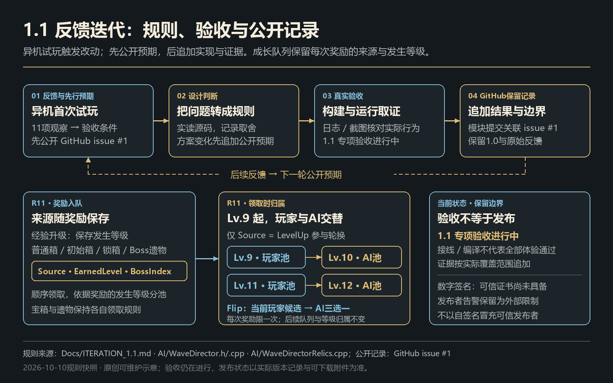

# AI队友协作生存原型：系统设计说明

> 规则快照：2026-10-10。当前源码为1.1迭代，完整Editor／BuildCookRun与独立开始页通过，PIE专项已取得回读；独立核心操作和最终封包仍待验，可下载版本为1.0。本文将1.1新增规则单独标注，下载与限制以[发布记录](RELEASE.md)、取证范围以[验证记录](RELEASE_VALIDATION.md)为准。

## 设计问题与目标体验

自动输出会削弱玩家的操作负担，也可能削弱参与感。本项目把主动决策放在站位、护卫／歼灭切换、构筑选择、金币消费和挑战时机上，让玩家与队友的关系持续影响战局。

玩家前期借助队友自动火力生存，Lv.6 解锁自己的自动索敌射击；选择玩家元素路线后，再由队友参与状态结算。地图探索、递增宝箱价、风险祭坛与 Boss 祭坛提供不同的成长入口。它们服务同一条局内循环，而不是相互独立的功能展示。


### 成长供给为什么分成三类

| 入口 | 现役规则 | 设计判断 |
| --- | --- | --- |
| 经验升级 | 三选一；一次性卡离池，可叠加卡保留；玩家武器未解锁时排除相关卡。1.1从Lv.9等级奖励起交替玩家／AI池 | 避免暂时无效的奖励，让后期每次成长的受益方更明确 |
| 经济与探索 | 普通箱价格为 `3 + 2 × 已开箱数`；锁箱给15金及六选二，钥匙是本局持有资格 | 让即时成长与跨地图寻宝竞争时间和资源 |
| Boss奖励 | 每个Boss固定三种专属遗物选一，三Boss共九种；与升级／锁箱串行排队 | 用机制挑战换构筑分支，并避免同帧奖励覆盖 |

稀有度乘子为普通1.0、稀有0.75、传说0.45。它们参与相对权重抽取，不能当作固定出卡概率。1.0的29个升级显示ID含金币袋与高爆兼容条目；1.1追加本体速射、陪伴疾行和Flip，共32个升级／操作显示ID。加九遗物为41条展示元数据，不能称41种技能：Flip只转换奖励，填位与兼容条目也不代表可构筑流派。

玩家冰／电／猎印三元素路线互斥，选定后保留对应深化。弹道是另一维：玩家穿透与折射可以同持，每个直接命中最多带一次不递归分叉，整发去重；玩家散射与这两项互斥。队友穿透与折射仍互斥。四个融合定义由前置组合入池，不能把展示夹具当作所有自然获取链已经验收。

### 1.1：奖励分工不能只看领取时的最终等级

作者反馈8级以后成长缺少玩家／AI分工。当前实现从**升到Lv.9的等级奖励**开始：Lv.9／11／13为玩家池，Lv.10／12／14为AI池。奖励入队时保存来源与发生等级；一次收集大量经验而连续升级时，后领取的旧奖励仍按自身等级归属，不按当前最终Level重新计算。普通箱、初始箱、锁箱和Boss遗物保留各自来源，均不进入这条轮换。

玩家等级奖励的第三槽固定为「Flip · 转交队友」，另两槽抽玩家收益候选。Flip将当前奖励切为AI三选一，不算领取、不授予技能、不追加下一奖励，也不改变下次归属；玩家需要再选一张AI卡。转换更新选择代次，旧卡面回调失效。固定一个操作槽减少当次玩家升级候选数量，换取明确的转交入口；是否能改善选择体验仍待自然局反馈。

| 1.1成长约束 | 当前规则与设计理由 |
| --- | --- |
| 普通猎印重复可获益 | 首抽解锁默认3层；每次再抽上限+1，普通成长无固定总上限。卡面显示当前次数与下一次增量，HUD悬停显示当前层数和每层处决伤害 |
| 金色深化不回退成长 | 猎杀大师取 `max(当前上限, 5)`，将每层处决强化至22伤；保留此前普通重复卡形成的更高上限 |
| 本体速射提供后期玩家收益 | 自动射击解锁后入池，间隔每次×0.85、下限0.15秒；达到下限后离池，避免无收益重复 |
| 陪伴疾行是玩家池协作选项 | 队友最高步速每次×1.10，最多3次且不超过玩家当前最高步速；只有存在真实增量时入池 |
| 候选不足仍有明确结果 | AI池填重击弹头，玩家／混合池填强身；锁箱填金币袋。显示填位原因，保留原领取数和奖励归属 |

完整说明由导演当前角色／队友状态生成，HUD仅传递Description；遗物说明由实际Relic组件提供。UI不另建一套卡池或效果参数。正式经验／选卡入口已测正常多级队列2…9、Lv.9 Flip后续Lv.10 AI及测试11→12；正式授予桥已核猎印上限3→6、大师保6、速射下限和疾行三次限制。它们不等于自然随机池分布、玩家速度钳制或真实敌人全部叠层／消费通过，详细数值和边界见[验证记录](RELEASE_VALIDATION.md)。

### 经济不是单一强化按钮

普通宝箱把金币直接转为成长；难度祭坛花8金币增加一档后续压力，敌人生命与XP分别乘 `1 + 0.3L`、`1 + 0.25L`，不增加金币倍率。信标免费拾取、解锁C召回，基础冷却20秒；闪烁需要选卡解锁，基础距离8米、冷却5秒。前者恢复队形，后者调整玩家位置，两者避免只靠提高移速处理危险。

1.1针对早期被追死的反馈，正常StartRun在出生点旁独立生成一次初始补给箱，金色闪光与免费文案区别普通箱；按E领取免费三选一，不扣金币、不增加付费箱次数，测试局不自动生成。标准杂兵基础速度从450降至405cm/s，其他变体／Boss保持原值，后期速度成长仍由导演负责。这是定向降低开场门槛的方案，不能在自然局复验前宣称已经解决难度或提高存活率。

### 挑战节点与离场边界

3／6／9分钟出现对应Boss祭坛，玩家通过接近祭坛开始挑战。召唤师考清杂破盾，巨像考落点与安全间隙，蠕虫考火区压缩、俯冲和破土预警。12分钟开启狂暴压力，不存在600秒自动胜利判定。

击败蠕虫会生成归途门，遗物与其他奖励队列领取完成后才能进入。走近后需要先松开E，再按E；同一次领奖按键不会直接穿透到结束页。进入后停止导演并真正暂停世界，感谢页按现实时间渐入。玩家也可暂不离场；死亡则进入结算与重开流程。

## AI落地：信息、评分与行动分别负责什么


队友复用 AI Perception、NavMesh 和 MoveTo。自定义部分是 Follow／Engage 两态 FSM、Utility 目标选择及玩家可控的移动策略。选择这一方案，是为了在有限原型范围内让设计目标、参数和决策原因直接对应；引擎感知与寻路不重复实现。

现役默认评分为：

```text
D = 1 - clamp(队友到敌人距离 / 视觉半径, 0, 1)
T = 敌人正在攻击玩家 ? 1 : 1 - clamp(敌人到玩家距离 / 1200cm, 0, 1)
V = 1 - clamp(当前生命 / 最大生命, 0, 1)
Score = 0.3D + 0.6T + 0.1V
        - (不是当前目标 ? 0.1 : 0)
        - (无视线 ? 0.35 : 0)
```

视觉半径默认2600cm，丢失半径3000cm；决策节拍0.25秒。玩家受击时，`OnDamaged` 的伤害来源通过 `HandlePlayerDamaged` 进入候选集，再由同一评分器判断。这解决的是候选信息缺失，单纯加伤害或调权重不能替代这条输入链。低权重残血分及切换惩罚分别约束「越打越残、越残越打」与频繁横跳。

护卫移动目标是玩家，默认让玩家收到的治疗增加10%；歼灭移动目标是评分最优敌人，让队友伤害增加10%。两模式共享评分和火力层，倍率在 `HealthComponent` 的唯一入口结算。模式改变保护与追击的取舍，切换权交给玩家。

协作也延伸到伤害结算：玩家制造感电，AI真实子弹直击配对4米内两个已带电普通敌人，两端各结算 `max(20, 本弹原伤×30%)`；过载为 `max(40, 本弹原伤×55%)`。玩家猎印通过 `ICombatant` 覆盖普通敌人和Boss，队友命中消费层数。冰／电与旧领域仍有普通敌人类型边界，不能把猎印的Boss支持扩写为全元素通用。

普通游玩不常驻显示评分；`bEnableScoreboard` 默认关闭，显式打开时可查看分项和选择，日志保留进入战斗及切换原因。参数来自 `UPROPERTY`、C++结构与数组；资源软引用等位于ini。当前没有把这些入口称为已完成的 `UDataTable` 数据管线。

1.1移动修订针对源码中反复向同目标发起MoveTo和步态读取旧路径点的风险：仍在执行／等待的相同目标与停止距离请求不重发，步态改读PathFollowingComponent当前目标位置，保持护卫／歼灭的目标和到达停止语义。5s坡地回读中221个PFC Moving状态样本平均477.64cm/s（含一个零速样本），配置最高500、请求0→1；停步末秒零速与请求稳定。急反向时玩家碰到队友后停留，完整转向／追击和人眼动画仍未验。本轮保留原双驱动，只修当前路径／去重，不以局部采样断言全部顿步根因消除或性能提升。

## 1.1：输入和信息回看也是系统体验

首次无Saved配置以1280×720窗口启动，已由独立候选运行对象与真实截图核对；标题页与暂停页都提供显示设置。窗口／无边框／全屏和分辨率使用UGameUserSettings真实应用／保存入口，已有用户配置优先，未点击应用不写入。PIE处理保存两种1280×720配置并重开回读，实际视口仍窗口，独立全屏与保存后进程重启待验。测试面板把返回菜单和收起放在滚动区上方，收起后保留展开条；文本取消固定34px行高，按真实字体测量与自然期望高度布局。当前27条可见文字分配高度无不足，另一窗口尺寸／滚动区外和独立中文下缘仍待实画验收。

暂停由GameMode统一仲裁，UI只提出请求。ESC或应用失焦打开暂停菜单；恢复仅解除这次SetGamePaused，不重置奖励选择原有的时间流速。尚有奖励时返回GameAndUI与可见鼠标，测试模式同样保留面板入口；死亡、终局和设置的排他输入上下文由宿主管理。这样可以把「恢复游戏」与「完成奖励」分开，避免菜单自行改时间而跳过待选卡。

队友发言、Boss祭坛实际生成与12分钟狂暴写入同一WorldSubsystem记录源，最多保留100条，界面按记录代次刷新并滚至最新。条目包含真实世界时间、说话人、文本和事件标识，重载本局时随世界清空。Lv.6真实解锁自动射击新增一次「看来你找回了一些自己的能力」，接气泡、事件框和预合成语音；正常／测试PIE已读到一次事件与SoundWave playing=true、4.44s，新增资源实际Cook。人工调钟触发三祭坛／狂暴记录，不等于自然12分钟体验；主观听音和100条长期边界未全部验收。运行时仍离线，没有LLM或TTS请求。

## 一次反馈怎样变成可验收约束


作者两次试玩反馈「火球飞过头顶仍扣血」。旧版隔离PIE复现球心高出玩家胶囊顶部310cm，仍扣12血；根因是将起终点与玩家投影到XY后按100cm距离判定，忽略了高度与地形。

规则修订把可见核心与命中球半径统一为35cm，从真实枪口三维瞄准、发射后直线飞行。每帧连续球扫实际玩家胶囊，同时检查会阻挡Pawn的地形／实体；按首次接触排序，同距地形优先。弹幕由三线改回单发，保留常态0.6秒／1600cm每秒、眩晕1.2秒／800cm每秒。

新版取得自然护盾单发迹线与地形命中销毁日志，作者在2026-10-09晚确认正常工作。这个案例证明反馈、几何约束、实现和验收能连成闭环；它没有给出全部地形／角度的命中覆盖率，也不替代完整包或长期性能测试。

另两条可复盘的设计取舍是：护主问题先修候选信息和威胁覆盖；回响过程从0.5秒5伤改为0.1秒1伤，维持名义10DPS，并按历史扩散半径补算低帧节拍。后者已有局部伤害迹线证据，不是帧率优化指标。

2026-10-10作者首次异机试玩1.0后，先在[GitHub #1](https://github.com/Meracle-sjj/AICompanionDemo/issues/1)记录11项反馈与验收条件，再追加来源／等级队列、无收益离池、移动请求及签名调查的判断。原[先行预期](ITERATION_1.1.md)保留，实装、编译和运行状态追加至[版本日志](../CHANGELOG.md)。1.1完整构建、Cook、独立开始页和PIE专项通过各自覆盖范围，核心独立键鼠仍待验；首次C4458失败、不支持分辨率QA断言和既有启动错误一起留存，不能把候选或局部成功写成全部体验／发布完成。



## 本人职责、证据与限制

本项目由作者一人主导，AI agent辅助实现。作者负责体验目标、规则与方案裁决、视觉／声音方向、实际试玩反馈、范围管理和最终验收；agent承担设计细化、代码、工具、资产生成接入、日志分析与文档。这个分工不等于真实多部门团队，也不表示全部C++由作者逐行手写。

开发从2026年8月开始持续迭代。封面的「整个国庆节假期」描述展示阶段，不能代替工程起止时间。没有规模化外部测试、留存数据或A/B统计；已获得的是作者试玩、编译、历史规则专项、重启／GC与资源Cook证据。完整试玩包与独立启动结果由[发布记录](RELEASE.md)维护，1.1仍在验证，正式视频尚未附出。可信发布者签名尚未解决，第三方取得／分发凭证缺口仍保留；公开源码排除原Content，不能单独恢复完整资产工程。

当前源码与材料索引见[证据索引](EVIDENCE.md)，图源及视觉参考说明见[图解说明](diagrams/README.md)，素材来源与公开边界见[第三方资源说明](THIRD_PARTY.md)。
