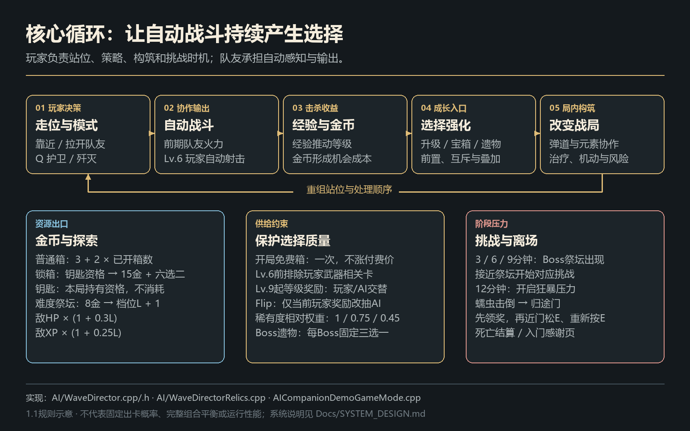
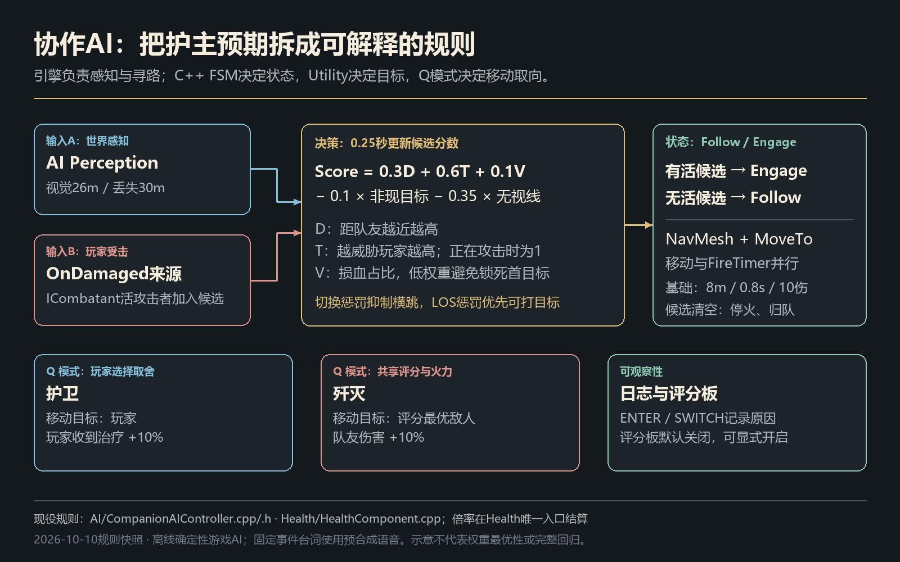
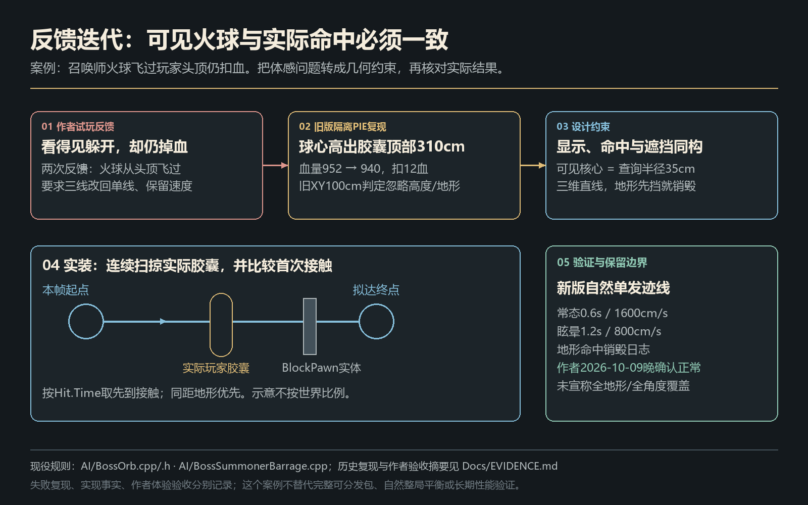

# AI队友协作生存原型：系统设计说明

本文对应当前版本 v1.3.2：统一实际伤害反馈与妖术师声音控制已接入，完整 Windows 构建、限定专项与两次独立启动／正常退出通过。下载入口为 [v1.3.2 Release](https://github.com/Meracle-sjj/AICompanionDemo/releases/tag/v1.3.2)。本轮反馈与目标见 [GitHub #5](https://github.com/Meracle-sjj/AICompanionDemo/issues/5)，此前修订保留在 [GitHub #4](https://github.com/Meracle-sjj/AICompanionDemo/issues/4)。[作品入口](../README.md) · [玩家指南](../PLAYER_GUIDE.md) · [修订摘要](../CHANGELOG.md)

## 设计目标与核心循环

自动战斗降低操作负担后，玩家仍需通过站位、护卫／歼灭切换、构筑选择、金币消费和挑战时机参与战局。玩家前期借助队友火力生存，Lv.6 解锁自身自动射击；协作路线让玩家制造状态、队友参与结算，形成持续的分工。



| 成长入口 | 当前规则 | 设计目的 |
| --- | --- | --- |
| 经验升级 | 三选一，按前置、互斥和次数筛选；Lv.9 起交替玩家／AI等级奖励 | 让成长收益和受益方更清楚 |
| 经济与探索 | 普通箱价为 `3 + 2 × 已开箱数`；锁箱给 15 金与六选二 | 让即时强化与探索竞争时间和资源 |
| 风险祭坛 | 花费 8 金增加压力；敌人生命、经验分别乘 `1 + 0.3L`、`1 + 0.25L` | 让玩家主动交换风险与成长效率 |
| Boss 奖励 | 三个 Boss 各提供三种专属遗物，击败后选一，与其他奖励串行领取 | 以机制挑战打开构筑分支 |

普通、稀有、传说的相对权重乘子分别为 1.0、0.75、0.45，并非固定出卡概率。展示目录包含 32 个升级／操作项与九种遗物；Flip、金币填位和兼容项也在目录内，不能据此称为 41 种技能。

玩家冰／电／猎印路线互斥。玩家穿透与折射可以同持，每个直接命中最多带一次不递归分叉，整发去重；散射与这两项互斥。队友穿透与折射保持互斥。融合按前置组合进入候选池，让玩家通过选择形成路线。

正常局提供一次免费初始箱，不增加付费箱价；标准杂兵基础步速为 405 cm/s。这两项针对开局追击压力，实际难度仍需自然局反馈。免费箱以常驻粗体 FREE!、紫色光晕和少量上浮光点表示免费机会；普通箱接近时平滑显现锁和导演当前价格，大锁箱只显示钥匙、不显示价格。标记纯展示，不修改原金币、钥匙与交互半径规则。

箱体使用实际网格底面九点探地，按地形法线倾斜并轻埋沙，保留自然错开的朝向与局部位置。展示组件朝向镜头，不阻挡输入或碰撞；游戏时钟推动光效和渐显，暂停冻结，领取、死亡、终局与世界释放清理。三类箱共用每局成功开箱次数：前三个成功箱各对应一句固定台词，第四个以后不再播开箱对白；失败与重复开启不计数。

## 后期成长的分工

等级奖励从 Lv.9 起按玩家、AI 交替：Lv.9／11／13……归玩家，Lv.10／12／14……归 AI。每份奖励保存产生时的等级；一次收集大量经验连升多级，也不会按领取时的最终等级重新分配。宝箱与 Boss 奖励保留自己的来源，不参与轮换。

玩家等级奖励抽满三张真实强化卡，数字 1／2／3 均用于领取强化；「Flip · 转交队友」作为独立页脚按钮与 F 键操作，不占强化槽。它只把当前奖励转换为 AI 三选一，随后仍需选卡，不授予技能、不改变下次归属或队列。来源与代次复验拒绝旧卡面回调，同帧 F 与数字键只执行转换一次，避免直接领取新池。

普通猎印首抽解锁 3 层上限，每次重复选择上限 +1；猎杀大师将上限提高至至少 5 层，保留已经更高的上限，并将每层处决伤害提高为 22。本体速射的射击间隔每次 ×0.85、最低 0.15 秒；陪伴疾行最多三次、每次队友最高步速 ×1.10，且不超过玩家当前最高步速。没有实际增量时离池，减少无收益奖励。

## 协作AI：信息、决策与行动



队友使用 AI Perception 感知、NavMesh 寻路和 MoveTo 执行；自定义 Follow／Engage 两态 FSM 与 Utility 选敌分别负责行为状态和目标。确定性规则让体验目标、参数与决策原因容易核对，适合有限制作周期的原型。

默认视觉半径 26 米、丢失半径 30 米，决策节拍 0.25 秒。目标评分为：

```text
D = 1 - clamp(队友到敌人距离 / 视觉半径, 0, 1)
T = 敌人正在攻击玩家 ? 1 : 1 - clamp(敌人到玩家距离 / 1200cm, 0, 1)
V = 1 - clamp(当前生命 / 最大生命, 0, 1)
Score = 0.3D + 0.6T + 0.1V
        - (不是当前目标 ? 0.1 : 0)
        - (无视线 ? 0.35 : 0)
```

玩家受击来源进入同一候选集，补上队友未直接感知到的威胁。威胁权重让保护玩家更重要，低权重残血项与切换惩罚控制追残和横跳。移动读取当前路径段，对仍在执行的同目标请求去重。

护卫跟随玩家，使玩家收到的治疗增加 10%；歼灭追击评分目标，使队友伤害增加 10%。倍率由统一伤害／治疗入口结算，UI 只展示状态。

协作也作用于伤害：玩家猎印覆盖普通敌人和 Boss，由队友命中消费层数。感电针对普通敌人，玩家射击额外生成 70% 弹伤的枪口散射侧弹，命中挂电 5 秒、重复命中刷新；队友每 0.5 秒配对 4 米内的两个带电活敌，标记不消费，每敌每拍最多一条链。每端原始伤害为 `max(10, 队友原弹伤×15%)`，过载为 `max(20, ×27.5%)`，实际倍率仍由统一伤害入口结算。电弧先于扣血建立并拥有独立短寿命，目标死亡只冻结端点，使致死放电仍能被看到。

实现入口：[CompanionAIController](../Source/AICompanionDemo/AI/CompanionAIController.cpp)、[HealthComponent](../Source/AICompanionDemo/Health/HealthComponent.cpp)、[WaveDirector](../Source/AICompanionDemo/AI/WaveDirector.cpp)。

## 挑战、输入与信息

3／6／9 分钟出现 Boss 祭坛；召唤师考清杂破盾，巨像考落点与安全间隙，蠕虫考火区、俯冲与破土预警。召唤师入场提醒幽紫结界的进攻窗口，巨像提醒远离狂怒地刺；三 Boss 出现与死亡各有专属语音。蠕虫地下阶段为 3 秒，新的低频碎岩循环跟随地下头部的地表位置，按玩家距离与潜地进程平滑增强，出土、死亡和世界结束停止。12 分钟进入狂暴。击败蠕虫后生成归途门，领取全部奖励，再近门松 E、重新按 E，进入暂停的感谢页；阵亡进入死亡结算。

暂停与奖励由同一宿主管理，恢复游戏保留待领取队列；显示设置从标题页和暂停页进入。事件回看保留最近 100 条队友发言与世界提示，重开清空。游戏运行时离线，固定台词使用预合成语音。

语音在每世界统一调度：普通对白 FIFO；六 Boss 事件和玩家受伤／恢复共八类紧急事件立即停止当前对白、吞掉全部旧待播队列，同级紧急事件取最新事实。奖励选卡冻结战斗时，这八类最高级台词与气泡继续演出，普通对白保持冻结、不能提前起播；ESC 或失焦导致的游戏暂停仍停止全部声音与字幕。道具固定录音每局实际起播最多三次，排队不预占额度；模式、召回成功和紧急事件不计入该道具限额。录音成功开始后才发布唯一字幕与事件记录，记录视图跨帧跟随最后一条，气泡使用固定宽度换行。

v1.3.2 复用金币／处决的同一透明反馈层，将全部 25 个现役扣血入口接到 Health 账本。业务命中明确提供伤害语义与落点；Health 保持原有模式倍率、减伤、钳制和受击／血量／死亡顺序，只在实际扣血后提交一次数值。它先保存实际量、位置与玩家／敌方／队友护卫或歼灭来源，再执行原回调，避免反伤、回血、模式切换或 Actor 销毁改写当次反馈。无敌、零伤害、已死目标不显示数字，致死的最后一拍仍可显示。

19 类现有伤害语义归入八种原创矢量图样：弹丸、冰晶、火／血滴、闪电、铡刀、地刺、光束、撞击，以类别颜色和来源小徽记补充辨识。金币仍取实际钱包正增量；伤害显示实际扣血额，两位四舍五入、裁尾零，正伤害不足 0.005 显示“<0.01”。统一层复用 32pt 粗体描边、每世界最多 64 条和 0.85 游戏秒弹跳上浮；移除调用处旧伤害文字与手工处决提示，治疗、拾取和“融化！”状态文字保持。暂停冻结，结束页清空并拒新；没有新增 HUD、第二份生命账本或伤害事件队列。伤害平衡、攻击节拍与状态机制均未改变。实现见 [HealthComponent](../Source/AICompanionDemo/Health/HealthComponent.cpp) 与 [CombatFeedbackSubsystem](../Source/AICompanionDemo/UI/CombatFeedbackSubsystem.cpp)。

妖术师蓄力／发射采用两条原创短 PCM，播放音量分别为 0.25／0.30、音高倍率均为 1；较低的音色来自原声合成。两声共享最多两个真实空间组件，成功起播后分别等待 0.5／0.2 游戏秒，拒绝的请求不占冷却。球形线性衰减为内圈 400 cm、外延 2000 cm，按实际镜头位置拒绝 24 米外请求；暂停或奖励低时间流冻结声音并拒新，来源死亡与世界结束释放组件。预算只约束声音，不延迟或取消技能与伤害。

逐焰灵核的步行火球保持直线运动，命中敌人或地形后爆炸、范围内每敌 30；闪烁追加三颗追踪球，直击 30 与同球邻敌范围 20 互斥。爆炸组件独立保留短命表现，不随火球销毁立即消失。裂地獠牙仅在概率成功触发地刺时播一次新短铡刀音，流血每拍不重播，伤害仍为直接 50 与每半秒流血 10。

测试模式的 F1 在自由点选与锁定战斗之间切换。点选模式保留移动、阻断鼠标视角输入；高层菜单和奖励优先，结束后恢复原模式。输入宿主管理自己的一次视角阻断与释放，离局清理。F1 显示为浅青键帽，旁边两行展示动作与当前状态，面板收起后仍可见；菜单或奖励中变灰。小地图同款 TAB 键帽只在缩小时显示，按住 TAB 放大时隐藏。展示只读宿主状态，不接输入或另存操作账本。

历史独立包崩溃的匹配 PDB 栈指向开始游戏时的特效预热：跨地图静态裸类缓存不受 GC 保活。特效库已改为弱引用，失效时按固定路径重载。旧版本的流转、GC 和冷启动专项保留为历史证据，不替代新修订的独立包验证。

## 从反馈到规则：火球公平性



作者试玩发现火球飞过头顶仍扣血。原因是命中判定投影到平面，忽略高度和地形。修订统一可见核心与 35 cm 球扫半径，按三维方向发射、连续检查实际胶囊和阻挡地形，并以首次接触结算；同距时地形优先。

修订后取得自然发射与地形阻挡记录，作者再次试玩确认正常。这个案例体现从体验反馈定位规则问题、约束几何，再检查实际表现的过程。实现见 [BossOrb.cpp](../Source/AICompanionDemo/AI/BossOrb.cpp)。

## 本人职责与制作范围

开发周期：国庆节整个假期＋后续3天（约10天），非假期利用空闲时间开发。

作者一人主导体验目标、系统关系、规则裁决、视觉与声音方向、实际试玩反馈、范围管理和最终验收。AI 辅助工具参与设计细化、代码、素材制作和接入。本人贡献定位为个人项目主导、系统设计与体验验收，AI 辅助实现。

旧版本标签、附件与反馈继续保留。v1.3.1 已复核完整 Windows 构建、受控修复专项、独立包的正式／测试入口、奖励领取、菜单和显示设置、死亡页按钮重开及两次正常启动与退出；四条固定配音沿原参考录音生成，人耳同人确认另验。

v1.3.2 已完成 Editor 与完整 Windows 构建，两条新 SoundWave 和原 BGM 的实际资源收录检查。限定场景核对实际量钳制、免伤／死亡、两种队友来源、反伤／流血，以及结束页图层隐藏与拒绝新反馈；非空存量清理保留既有验证基线。多妖术师声音检查覆盖叠响上限、距离拒绝、暂停／恢复、来源死亡与世界释放。八图样展示只证明绘制方式，未据此声称每种自然战斗均通过。两个新独立进程均启动并正常退出，覆盖测试／正常入口、菜单、暂停与奖励界面；未见 Fatal，仍有既有材质日志错误。人耳听感、自然整局、全部构筑、长期性能、异机与本版持续按键操作尚未验证。

本作复用 Epic 模板、Paragon 等资源，并包含 AI 辅助插画、预合成语音和程序几何。来源与分发限制见[第三方资源说明](THIRD_PARTY.md)。公开源码不含 Content，供实现评审，不能单独恢复完整可玩工程。
